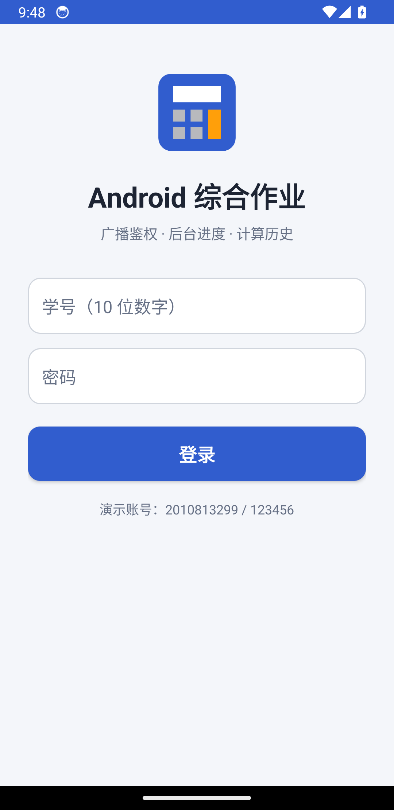
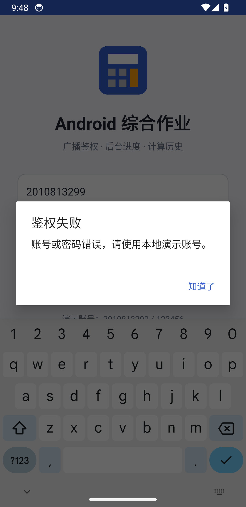
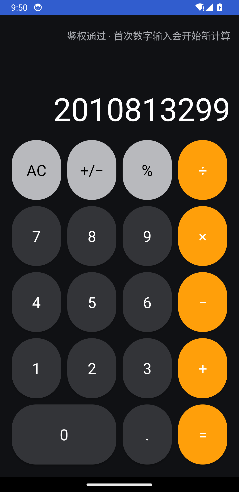
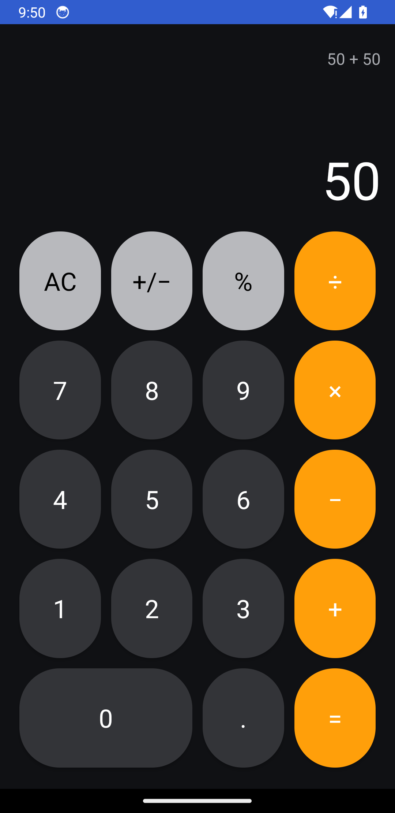
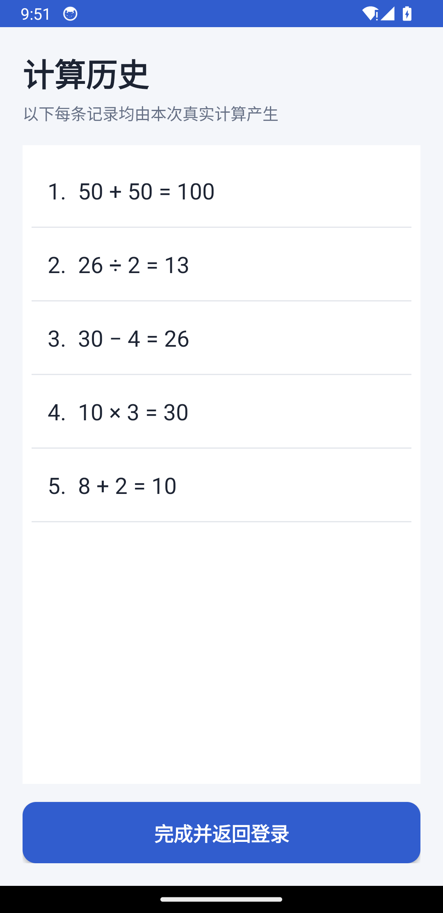
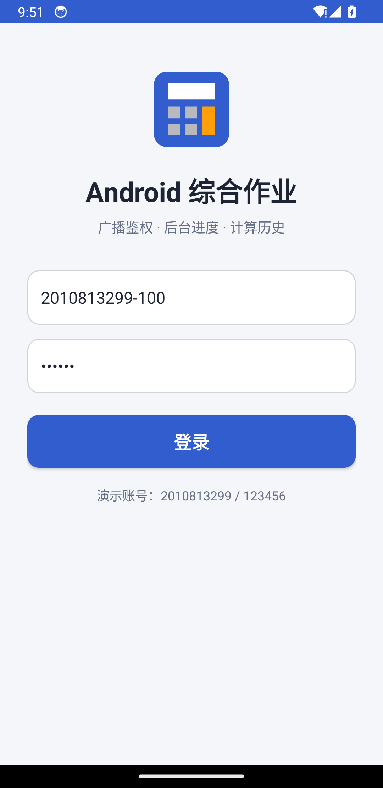
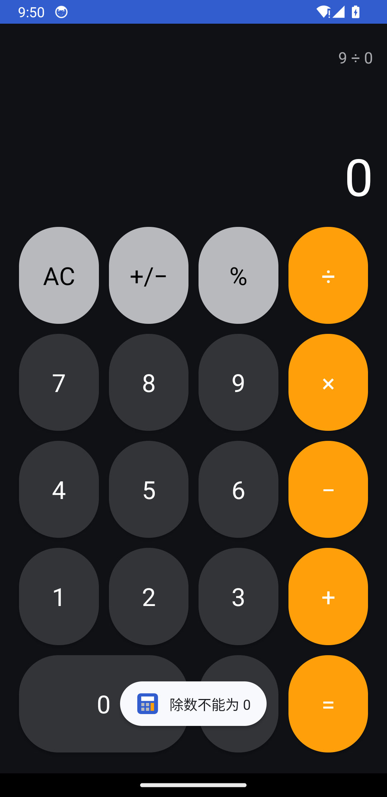

# Android 登录 + 计算器 + 结果列表综合作业

一个完全使用 **Java + XML Views** 实现的 Android 课堂作业。项目包含广播鉴权、约 10 秒异步进度、GridLayout 计算器、真实 ListView 计算历史，以及关闭历史页后广播结果并清空 Activity 栈返回登录页的完整流程。

## 演示账号

- 学号：`2010813299`
- 密码：`123456`

账号仅用于本地课堂演示，没有网络请求，也不代表真实个人信息。密码输入框使用系统 `textPassword` 掩码；密码不会写入日志或结果广播。

## 核心功能

- `LoginActivity` 的根布局为 `LinearLayout`，包含学号、密码和登录按钮。
- 使用显式、应用内的有序 `ACTION_AUTH` 广播，由 `AuthReceiver` 校验账号并返回鉴权结果。
- 错误账号、空值、学号格式错误会显示真正的 `AlertDialog`。
- 鉴权成功后由后台 `ExecutorService` 执行约 10 秒任务，主线程 `Handler` 连续更新 0–100 的进度。
- `CalculatorActivity` 的按键区为真正的 XML `GridLayout`；灰、黑、橙色按钮均使用 drawable selector 提供按压反馈。
- 支持 `+`、`−`、`×`、`÷`、`AC`、`+/−`、`%`、小数、链式运算、长输入限制和除零提示。
- `CalculatorEngine` 使用 `BigDecimal`，整数结果不带多余 `.0`。
- 按 `=` 后打开 `HistoryActivity`，用真正的 `ListView` 展示本次实际产生的算式和结果。
- 点击“完成并返回登录”或系统返回键时仅发送一次 `ACTION_CALC_FINISHED` 广播；登录页接收 M 后用 `NEW_TASK | CLEAR_TASK` 重建，显示 `原学号-M` 并保留掩码密码。

## 构建与运行

环境要求：Android Studio（或 JDK 17+）、Android SDK 34、可用的 API 23+ 设备。

```bash
./gradlew assembleDebug testDebugUnitTest
adb install -r app/build/outputs/apk/debug/app-debug.apk
adb shell am start -n com.example.logincalculator/.LoginActivity
```

本项目实际使用 Android API 34 ARM64 模拟器完成安装和验收。可直接安装的 APK 位于 [`artifacts/LoginCalculatorAssignment-debug.apk`](artifacts/LoginCalculatorAssignment-debug.apk)。

## 真实运行截图

所有图片均由 API 34 模拟器通过 `adb exec-out screencap -p` 获取，原始分辨率为 1080×2220；没有使用生成式图片替代运行结果。

| 证据 | 说明 |
|---|---|
|  | 初始登录页 |
|  | 错误密码触发真实 AlertDialog |
|  | 10 秒任务进行到 50% |
|  | 计算器首次显示学号 |
|  | 实际输入 `50 + 50` |
|  | ListView 展示五条真实结果，首条 M=100 |
|  | 清栈后学号为 `2010813299-100`，密码保持掩码 |
|  | 除零错误的真实 Toast |

## 测试结果

- Gradle：`assembleDebug` 与 `testDebugUnitTest` 成功。
- JUnit：6/6 通过，覆盖四则运算、符号、百分比、小数精度、除零和非法数字。
- 设备验收：错误密码、正确密码、10 秒进度、首次学号、AC、`+/−`、四则运算、除零、`50 + 50 = 100`、真实 ListView、按钮关闭广播、系统返回键广播、清栈、后缀和密码掩码全部通过。
- 两次实测进度耗时：10,130 ms、10,117 ms。
- 主路径 HistoryActivity 展示：`50 + 50 = 100`、`26 ÷ 2 = 13`、`30 − 4 = 26`、`10 × 3 = 30`、`8 + 2 = 10`。

完整命令和结果见 [`docs/验证记录.md`](docs/验证记录.md)，逐条要求映射见 [`docs/作业报告.md`](docs/作业报告.md)。设备 UI XML 与 logcat 原始证据保存在 [`evidence/`](evidence/)。

## 说明与局限

- 这是本地教学鉴权，不连接服务器；账号写在 `AppContract` 中便于课堂验收。
- 计算历史仅在当前计算器会话的内存中保存，不使用数据库。
- Activity 固定为竖屏，避免 10 秒演示过程中旋转导致课堂展示中断；后台任务在 Activity 销毁时会取消。
