# Android 登录、计算器与结果列表综合作业报告

## 一、作业概述

本项目依据 `references/assignment_requirements.png` 的 8 条最终要求实现。技术路线为 Java、XML Views、原生 Activity、BroadcastReceiver、Executor/Handler、GridLayout、ListView 和 BigDecimal。应用包名为 `com.example.logincalculator`，最低 API 23，目标 API 34。

完整行为序列已经在 API 34 ARM64 模拟器真实执行：

> 登录输入 → 有序广播鉴权 → 失败 AlertDialog / 成功后约 10 秒异步进度 → 计算器首次显示学号 → 真实计算 → HistoryActivity/ListView → 关闭历史页发送结果广播 → 清空任务栈 → 登录页显示 `原学号-M` 并保留掩码密码

## 二、8 条要求逐项映射

| 序号 | 要求 | 实现与证据 |
|---|---|---|
| 1 | 图片/drawable，按下与抬起不同 | `ic_calculator.xml` 图标；`key_dark_selector.xml`、`key_light_selector.xml`、`key_orange_selector.xml` 和 `login_button_selector.xml` 均按 `state_pressed` 切换颜色。代码图见 `evidence/code/06_key_orange_selector.png`。 |
| 2 | 登录 LinearLayout，计算器 GridLayout | `activity_login.xml` 根节点为 LinearLayout；`activity_calculator.xml` 按键区为 4×5 GridLayout。运行效果见 01、04，源码图见 05。 |
| 3 | 学号和掩码密码 | 学号为数字输入，密码为 `textPassword`。07 截图和 `ui_return_state.xml` 均证明密码节点 `password=true` 且显示 `••••••`。 |
| 4 | 真实广播鉴权和 M 返回 | `ACTION_AUTH` 使用显式、未导出的 `AuthReceiver` 和有序广播结果；`ACTION_CALC_FINISHED` 仅带原学号和 M，并限制当前包。密码不进入日志和结果广播。 |
| 5 | 失败 AlertDialog | 空值、非 10 位学号、错误账号或密码均拒绝；错误密码实测截图见 02。 |
| 6 | 成功后约 10 秒后台进度 | 单线程 Executor 每 100 ms 推进 1%，Handler 更新 UI；按钮与输入框禁用防重复。两次真实耗时为 10,130 ms 与 10,117 ms，截图 03 为 50%，结束后截图 04 首次显示学号。 |
| 7 | 四则计算与 ListView | BigDecimal 支持四则、AC、正负号、百分比、小数、链式结果、除零和长输入限制。主路径 ListView 展示 5 条实际结果，首条为 `50 + 50 = 100`，见 05、06 和 `ui_history_state.xml`。 |
| 8 | 关闭 History 后广播、清栈、保留输入并追加 M | 点击完成按钮和系统返回键两条路径都实测。广播由登录页动态 Receiver 接收，使用 `NEW_TASK | CLEAR_TASK` 重建。按钮路径得到 `2010813299-100`，返回键路径得到 `2010813299-2`；两者密码均保持掩码。 |

## 三、主要类与资源

### 1. `LoginActivity`

- 注册 `ACTION_CALC_FINISHED` 动态接收器；Android 13+ 使用 `RECEIVER_NOT_EXPORTED`。
- 发送显式有序 `ACTION_AUTH`，最终接收器根据 result code 决定弹框或启动进度。
- `AtomicBoolean` 防止重复登录和重复跳转。
- `ExecutorService` 执行后台计时，`Handler` 在主线程安全更新进度。
- 收到 M 后读取当前密码输入框，在应用内部 Intent 中传给全新登录页；结果广播自身不带密码。

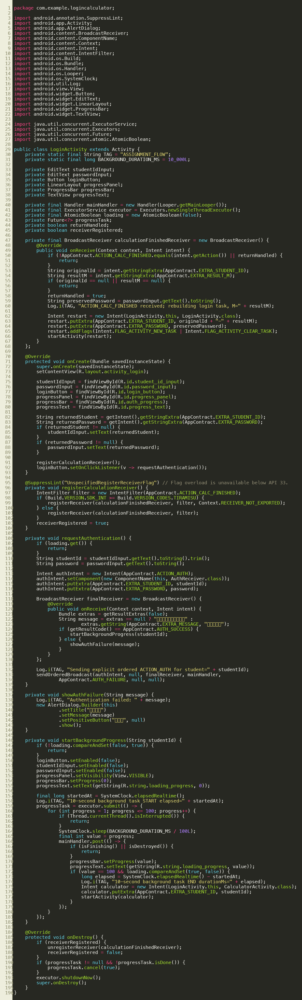

### 2. `AuthReceiver`

Manifest 中 `android:exported="false"`。它验证空值、10 位格式和固定演示账号，并通过有序广播的 result code/result extras 返回结果。

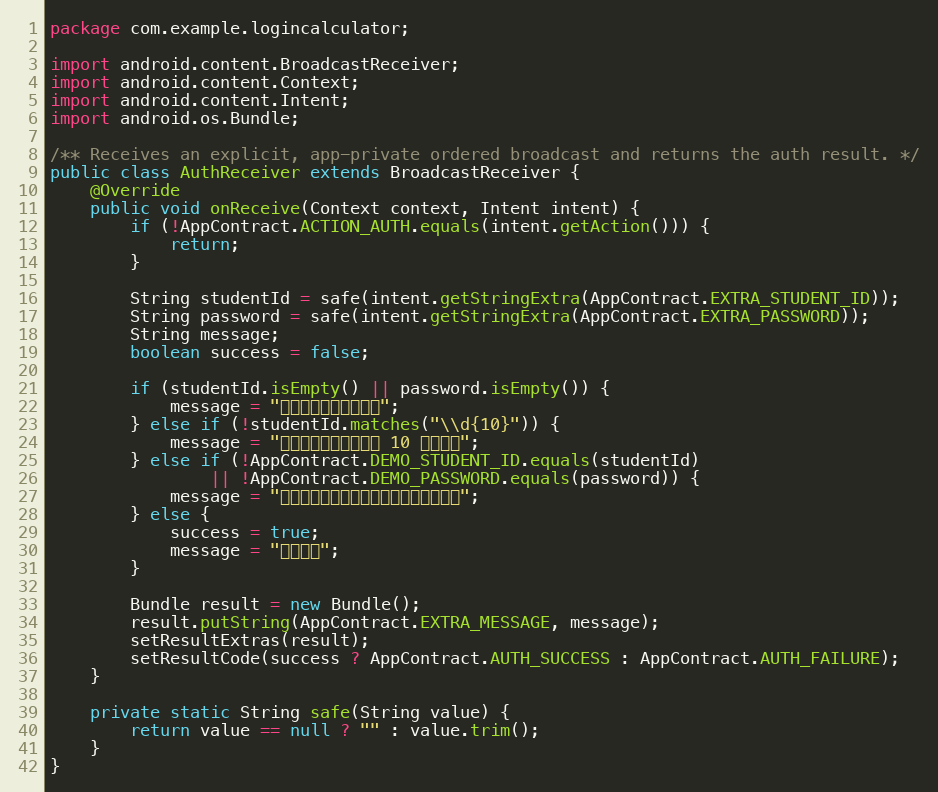

### 3. `CalculatorActivity` 与 `CalculatorEngine`

Activity 管理按键状态、运算符、左右操作数和历史列表；纯 Java Engine 使用 BigDecimal 执行计算并规范化显示。首次数字输入会替换学号，不会拼接到学号后。选择新运算符时会保存有效链式中间结果；按等号后将最新记录插入列表首位并启动 HistoryActivity。

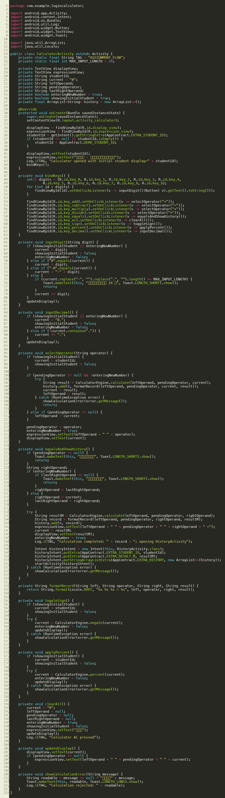

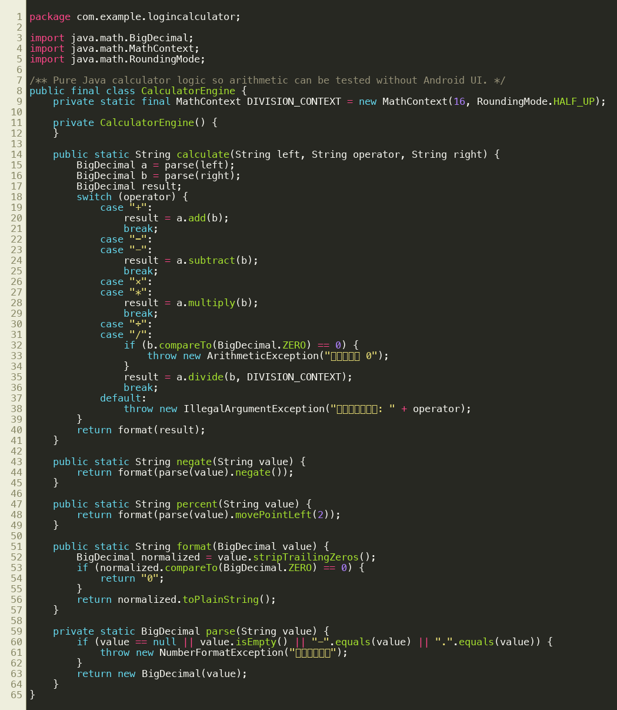

### 4. GridLayout 与按键 selector

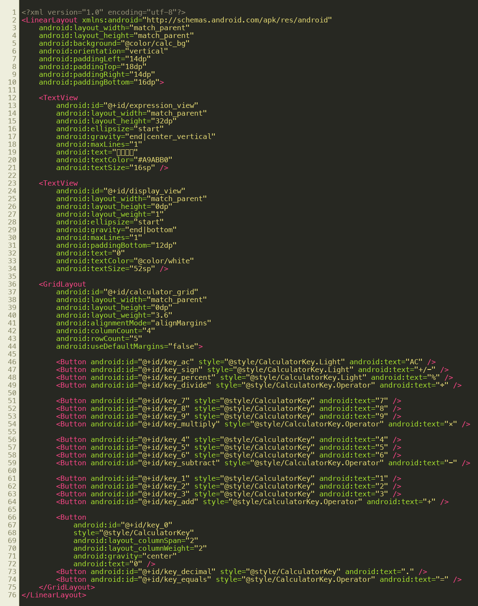

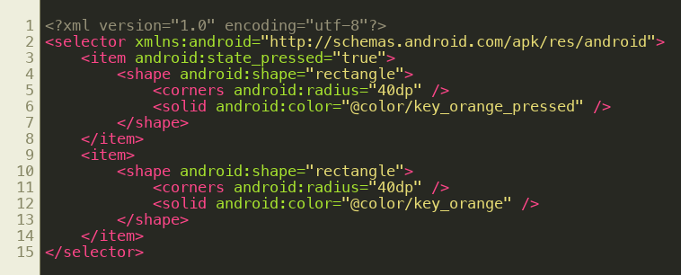

### 5. `HistoryActivity`

Intent 接收真实算式列表，用 ArrayAdapter 填充原生 ListView。按钮和系统返回键调用同一个 `finishWithBroadcast()`；`broadcastSent` 保证只发送一次，广播只包含原学号和 M。

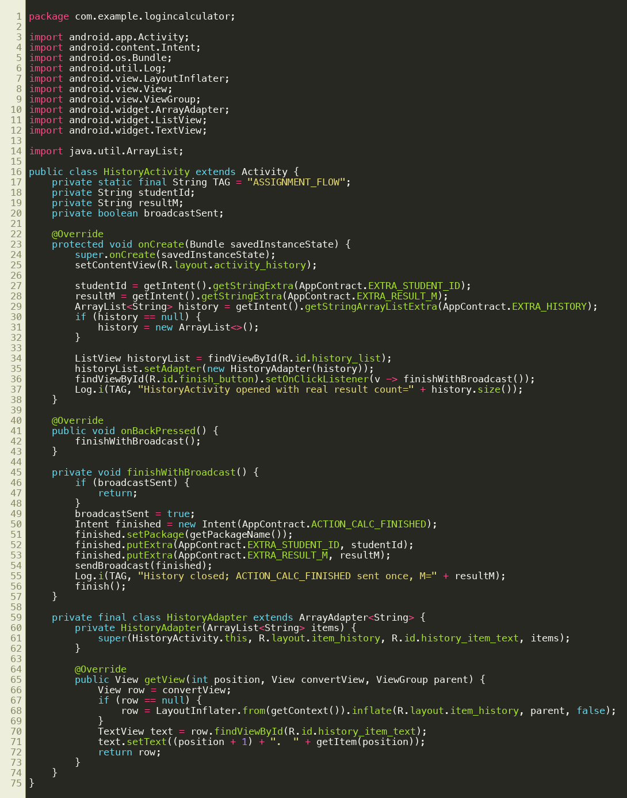

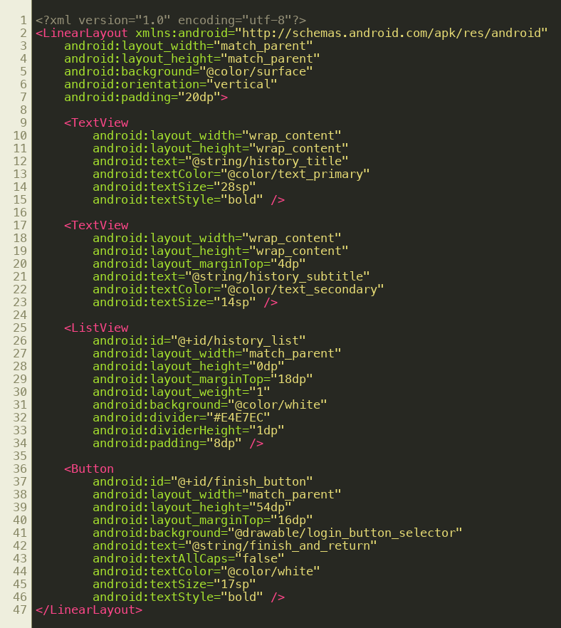

以上 8 张为 Pygments 对项目真实源码的带行号渲染截图，不是伪造的 IDE 界面。

## 四、广播与数据流程

1. LoginActivity 将学号和密码放入显式 Intent，组件固定为应用内、未导出的 AuthReceiver。
2. AuthReceiver 通过有序广播 result code 返回成功或失败；密码不会输出到日志。
3. 登录成功时只把学号传给 CalculatorActivity。
4. CalculatorActivity 把学号、M 和真实历史通过显式 Activity Intent 传给 HistoryActivity。
5. HistoryActivity 关闭时发送包内 `ACTION_CALC_FINISHED`，附加数据只有 `student_id` 和 `result_m`。
6. 仍存活的 LoginActivity Receiver 收到广播后读取自己的掩码密码输入状态，创建带 `CLEAR_TASK` 的新 LoginActivity。
7. 新登录页显示 `原学号-M`；旧 Login、Calculator、History 全部从栈中移除。

## 五、真实执行结果截图

### 初始、失败与进度

### 计算器、结果和返回

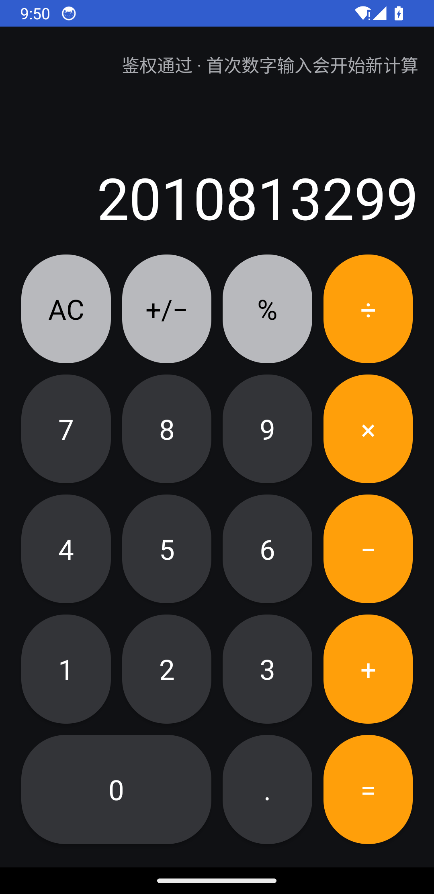

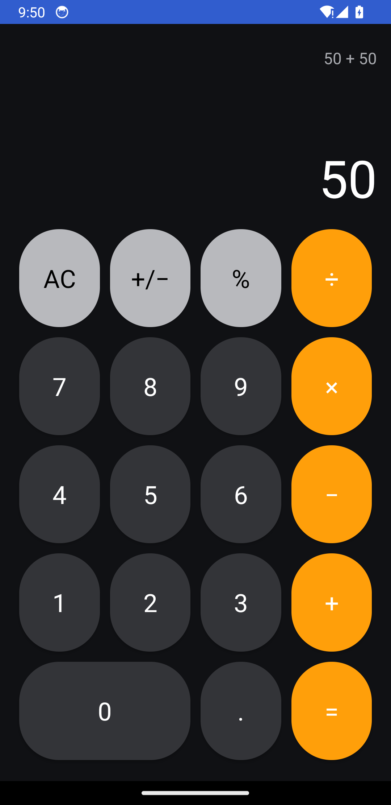

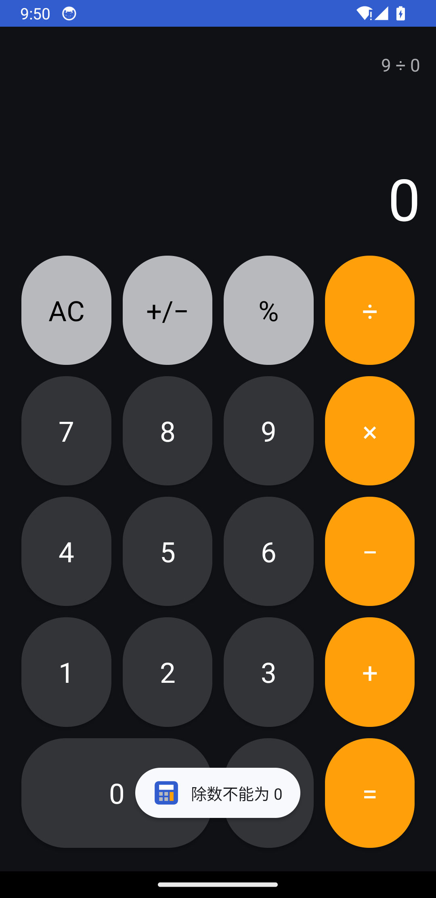

## 六、测试表

| 测试项 | 实际结果 | 证据 |
|---|---|---|
| 错误密码 | PASS，显示 AlertDialog，不进入进度 | 02、logcat |
| 正确密码 | PASS，进入后台进度 | 03、logcat |
| 进度耗时 | PASS，10,130 ms；复测 10,117 ms | `assignment_flow_logcat.txt` |
| 初始学号 | PASS，显示 `2010813299` | 04、UI XML |
| 首个数字不拼接学号 | PASS，输入 50 后显示 50 | 05 |
| AC | PASS，多次清零且无崩溃 | logcat |
| `+/−` | PASS，5 变为 -5 | `ui_sign_state.xml` |
| 加减乘除 | PASS，UI 链式产生 10、30、26、13 | 06、`ui_history_state.xml` |
| 50 + 50 | PASS，M=100 | 05、06、logcat |
| 除零 | PASS，拒绝并 Toast“除数不能为 0” | 08、logcat |
| ListView | PASS，原生 ListView，5 条真实记录 | 06、UI XML |
| 完成按钮返回 | PASS，只广播一次，清栈，显示 `-100`，密码掩码 | 07、UI XML、logcat |
| 系统返回键 | PASS，只广播一次，清栈，复测显示 `-2`，密码掩码 | `ui_back_return_state.xml`、logcat |
| 单元测试 | PASS，6/6，0 failure，0 error | Gradle XML 报告 |

## 七、结论

项目已完成构建、安装、运行、功能测试、截图和报告归档。所有核心运行截图来自真实 API 34 模拟器；源码截图来自当前仓库真实文件。详细命令、首次失败与修复记录见《验证记录》。
